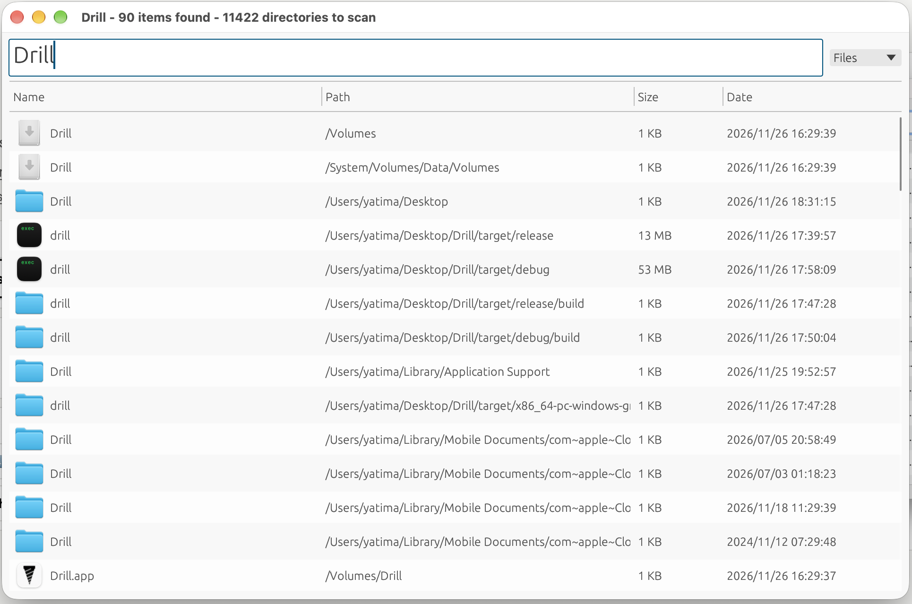

# Drill

Very fast file searcher without indexing

[Download latest release](https://github.com/yatima1460/Drill/releases/latest)


[](https://github.com/yatima1460/Drill/actions/workflows/rust.yml)
[](https://opencollective.com/Drill) [](https://github.com/yatima1460/Drill/issues)
[](https://github.com/yatima1460/Drill/network)
[](https://github.com/yatima1460/Drill/stargazers)
[](https://github.com/yatima1460/Drill/blob/master/LICENSE)

[](https://x.com/intent/tweet?text=Wow:&url=https%3A%2F%2Fgithub.com%2Fyatima1460%2FDrill)

<!-- Get notified for latest releases
[](https://telegram.me/drill_search) -->

## TL;DR: What is this

- Multithreaded
- Use as much RAM as possible for caching stuff
- Heuristics to prioritize more important folders
- **Intended for desktop users**, no obscure Linux files and system files scans
- Betting on the future: being tested only for SSDs/M.2 or fast RAID arrays





## Run

### From source

Install Rust using [rustup](https://rustup.rs/), then run:

```bash
cargo run --release
```

On macOS, double-click `Start Drill.command` to build and start Drill. The first build downloads Rust dependencies. Search results appear while the filesystem is scanned. Type `*.md` to find Markdown files, `glob:report-??.pdf` for a wildcard pattern, `regex:^IMG_[0-9]{4}\.jpg$` for a regular expression, or `fuzzy:` followed by words for approximate matching. Drill follows your system light or dark appearance and displays native file icons when available.

Run `make help` to see common commands, including `make start`, `make test-core`, and `make test-ui`. The native UI tests drive a real window and may move the mouse or type; on macOS they require Accessibility permission. Linux UI tests use Xvfb and Openbox.

See [Rust migration notes](docs/rust-migration.md) for development checks and platform status. Existing downloadable releases predate this Rust version.

## What happened to the old code?

The old D code and other experimental versions are available in the other branches
The former Python implementation remains available in Git history.

## What is this in detail

I was stressed on Linux because I couldn't find the files I needed, file searchers based on system indexing (updatedb) are prone to breaking and hard to configure for the average user, so did an all nighter and started this.

Drill is a modern file searcher for Linux that tries to fix the old problem of slow searching and indexing.
Nowadays even some SSDs are used for storage and every PC has nearly a minimum of 8GB of RAM and quad-core;
knowing this it's time to design a future-proof file searcher that doesn't care about weak systems and uses the full multithreaded power in a clever way to find your files in the fastest possible way.

* Heuristics:
The first change was the algorithm, a lot of file searchers use depth-first algorithms, this is a very stupid choice and everyone that implemented it is a moron, why? 
You see, normal humans don't create nested folders too much and you will probably get lost inside "black hole folders" or artificial archives (created by software); a breadth-first algorithm that scans your hard disks by depth has a higher chance to find the files you need.
Second change is excluding some obvious folders while crawling like `Windows` and `node_modules`, the average user doesn't care about .dlls and all the system files, and generally even devs too don't care, and if you need to find a system file you already know what you are doing and you should not use a UI tool.

* Clever multithreading: The second change is clever multithreading, I've never seen a file searcher that starts a thread *per disk* and it's 2019. The limitation for file searchers is 99% of the time just the disk speed, not the CPU or RAM, then why everyone just scans the disks sequentially????

* Use your goddamn RAM: The third change is caching everything, I don't care about your RAM, I will use even 8GB of your RAM if this provides me a faster way to find your files, unused RAM is wasted RAM, even truer the more time passes.

# Contributing
Read the Issues and check the labels for high priority ones

## Contributors

### Code Contributors

This project exists thanks to all the people who contribute. [[Contribute](CONTRIBUTING.md)].
<a href="https://github.com/yatima1460/Drill/graphs/contributors"></a>

### Financial Contributors

Become a financial contributor and help us sustain our community. [[Contribute](https://opencollective.com/Drill/contribute)]

#### Individuals

<a href="https://opencollective.com/Drill"></a>

#### Organizations

Support this project with your organization. Your logo will show up here with a link to your website. [[Contribute](https://opencollective.com/Drill/contribute)]

<a href="https://opencollective.com/Drill/organization/0/website"></a>
<a href="https://opencollective.com/Drill/organization/1/website"></a>
<a href="https://opencollective.com/Drill/organization/2/website"></a>
<a href="https://opencollective.com/Drill/organization/3/website"></a>
<a href="https://opencollective.com/Drill/organization/4/website"></a>
<a href="https://opencollective.com/Drill/organization/5/website"></a>
<a href="https://opencollective.com/Drill/organization/6/website"></a>
<a href="https://opencollective.com/Drill/organization/7/website"></a>
<a href="https://opencollective.com/Drill/organization/8/website"></a>
<a href="https://opencollective.com/Drill/organization/9/website"></a>